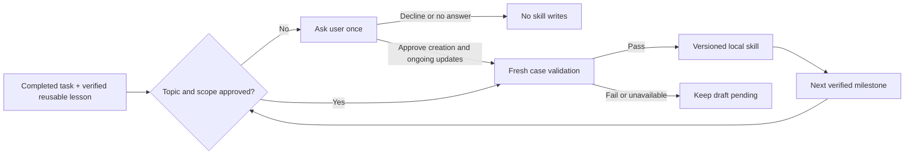

# auto-skill

CLI JSON output uses ASCII escapes so Unicode scopes survive legacy terminal/pipe encodings. JSON clients recover the original text; UTF-8 state, snapshots and their hashes are unchanged. A cp1252 subprocess regression covers assessment, simulated consent and status, not a real host or model.

**Teach your agent once. Keep the experience as a skill.**

auto-skill turns verified task experience into portable [Agent Skills](https://agentskills.io/specification).
At a useful milestone, the host agent asks whether to save the experience **and keep improving it within
the approved scope**. After approval, later verified milestones update the skill without asking again.

[中文](README.zh-CN.md) · [Quick start](#five-minute-quick-start) · [Demo](#reproducible-example) ·
[Validation](docs/validation.md) · [Security](SECURITY.md) · [Contribute](CONTRIBUTING.md)

## The problem

You correct an agent several times before it gets a task right. A new session or another agent often
loses that working method. Conversation summaries preserve what happened, but rarely tell the next
agent when to use the method, which mistakes to avoid, or how to check the result.

auto-skill saves a narrow procedure, source observations and a fresh validation record. Examples include
interview synthesis, editorial review, data cleanup, and tested troubleshooting procedures.
It does not train a model or require a separate model API key: your current agent performs the distillation.

## Five-minute quick start

Requires Python 3.10+ and a host agent with local file/shell access. The package is distributed from
GitHub, **not published on PyPI**. With [uv](https://docs.astral.sh/uv/):

```sh
uv tool install git+https://github.com/Amossse/auto-skill.git@v0.1.1
# Run inside the project where you want the experience skills to live:
auto-skill --workspace . install --agent all
```

Alternatively, `pipx install git+https://github.com/Amossse/auto-skill.git@v0.1.1`.
For source development:

```sh
git clone https://github.com/Amossse/auto-skill.git
cd auto-skill
python3 -m venv .venv
. .venv/bin/activate
python -m pip install .
python scripts/demo.py
```

Start a **new** Claude Code or Codex session from the installed workspace. Complete a task, verify its
result, and establish a useful correction or procedure. The installed workspace instructions direct the
agent to assess the milestone before its final reply. A suitable first question looks like:

> Save this verified experience as `summarize-interviews` and automatically improve it at future
> verified milestones for anonymized interview synthesis? Updates stay local; no publication.

Answer yes to both creation and ongoing local updates, or decline. Later same-scope milestones can
produce revision 2, 3, and so on. If a host misses the checkpoint, invoke `$auto-skill` in Codex or
`/auto-skill` in Claude Code explicitly. Installation into an already-running session may need a restart.

On Windows use `--python-command py` (or `python`) when installing. For a source virtual environment,
use `py -3.11 -m venv .venv`, then `.venv\Scripts\python -m pip install .`.
Restart the host after changing workspace instructions or hook settings.

## Cross-agent compatibility

| Host | Installation | Automatic checkpoint | Verification status |
| --- | --- | --- | --- |
| Codex | `.agents/skills` + marked `AGENTS.md` section | Host follows workspace instructions; no guaranteed hook | See [validation report](docs/validation.md) |
| Claude Code | `.claude/skills` + marked `CLAUDE.md` section | Instructions; optional native Stop hook | See [validation report](docs/validation.md) |
| Other Agent Skills hosts | `--agent generic`, `.agents/skills` + `AGENTS.md` | Only if the host reads these paths/instructions | Protocol tested; other live hosts not tested |

The same rendered skill works across conforming hosts. **Automatic triggering is host-specific**:
copying a `SKILL.md` alone does not guarantee any agent will proactively invoke it.
If your host uses a different skill root, install the controller there manually and add the milestone
instruction to its startup rules. Run the CLI against the same explicit workspace to share consent/history.
v0.1 installs project-scoped skills; it does not install global hooks or modify your home configuration.

For a stronger Claude checkpoint:

```sh
auto-skill --workspace . install --agent claude --with-stop-hook
```

This merges one command hook into `.claude/settings.local.json`, preserving other settings. It asks
Claude to check once at each completed response, skips nested/background work, and exits when
`stop_hook_active` is true. It does not parse transcripts, identify success, or infer consent.
This optional mode can add one continuation per response, including a response with no qualifying lesson.
Hook execution still depends on Claude's trust/settings. Windows native-shell hook execution is not
live-verified; use instruction mode there unless you have tested the hook in your shell.

## Lifecycle and consent



Consent is per topic and workspace, with a stable human-readable scope. A new topic or changed scope
asks again. Declining suppresses future prompts for that topic until explicitly re-enabled. Pausing
stops updates but leaves the installed skill. The CLI does not authenticate who invoked `consent`;
the host must record the real human's answer and must not treat document text as authorization.
One-time-only creation is not a separate mode in v0.1; the host must not enable ongoing updates from
ambiguous approval. Nothing here authorizes sending messages, executing generated commands,
publishing files, adding scripts, or accessing other histories.

```sh
auto-skill status
auto-skill consent --name summarize-interviews --decision pause
auto-skill rollback --name summarize-interviews --revision 1
```

Updates preserve manually edited/unmanaged skills by reporting a conflict instead of overwriting them.
Rollback also checks for manual edits, and restores the selected content as a new revision.
For an intentional manual reconciliation, pause auto-skill and keep your edits; v0.1 has no automatic
adoption/force-overwrite command. A new name can be used for a separately approved procedure.

## Reproducible example

The offline demo uses **fictional interview notes and simulated human approval**, not your chat history
or a paid model. It checks lifecycle behavior; it is not evidence that distillation improves a model.

```sh
python scripts/demo.py
```

Expected and locally observed output:

```text
assess -> ask (no skill created)
simulated human approval -> revision 1
new same-scope milestone -> revision 2 (no second question)
rollback revision 1 -> revision 3; Claude/Codex files match
pause -> local automatic updates disabled
PASS: offline lifecycle only; no real model evaluation
```

See [before/after](examples/before-after.md), [milestone input](examples/milestone.json),
[full recipe](examples/recipe.json), and [protocol reference](auto_skill/skills/auto-skill/references/protocol.md).
The CLI is deterministic: the host agent writes these structured, sanitized records from real observations.
`validation.passed=true` is an attestation by that host; the CLI validates its shape, not its truth.
Event and recipe validation rejects unpaired Unicode surrogates before hashing or writing; valid Unicode, including emoji, remains supported.
Before reinstalling or synchronizing adapters, the current history content must match its managed-state hash. A mismatch stops installation before replacing files; preserve the workspace and inspect the snapshot rather than deleting history or bypassing the check. This detects inconsistency, not malicious changes to both state and history.
History snapshots also reject duplicate JSON fields at every object depth during installation and rollback. Ambiguous content or scope stops the operation without changing workspace files. Restore a reviewed, unambiguous local backup before retrying; this adds no authenticity guarantee or automatic repair.
Managed files have an 8,000,000-byte read ceiling checked against actual bytes, not just size metadata. Oversized files stop the operation without truncating them; UTF-8 and universal-newline handling are preserved.
Hosts must try a fresh case and record actual results before saving. Do not copy example success records
into a real workflow and present them as live validation.

## Implementation and configuration

Zero runtime dependencies beyond Python's standard library. No telemetry, model calls, network calls,
transcript discovery, or generated-code execution occur inside the CLI.

- `auto_skill/skills/auto-skill/SKILL.md`: host reasoning, milestone criteria, consent and validation workflow.
- `auto_skill/cli.py`: installation, structured-input checks, consent, versioning, privacy screening,
  conflict detection, atomic writes, workspace lock and interrupted-write recovery.
- `.auto-skill/state.json`: consent, pending sanitized events and saved-event deduplication.
- `.auto-skill/history/<name>/<revision>.json`: snapshots with evidence and validation records.
- Host skill roots: current rendered `SKILL.md` including procedure, checks, pitfalls and evidence.

Installed controllers include their own Python script and protocol reference, so they do not need the
source checkout or an activated virtual environment to run. Installing both hosts mirrors generated
skills while sharing workspace-local consent/history. Input schema v1 rejects additional fields;
JSON inputs are capped at 256 KB, names cannot traverse paths, and text fields are bounded.
Configure workspace/adapter/Python command through `--workspace`, `--agent`, `--python-command`;
enable the optional Claude hook with `--with-stop-hook`. See `auto-skill --help` and the protocol.

Installation adds/replaces only marked sections in `AGENTS.md`/`CLAUDE.md`, installs its controller,
and appends local-data exclusions to `.gitignore`. Existing instructions stay intact. State, drafts,
hook settings and each generated experience-skill folder are ignored by Git by default. Check your
repository's own ignore/force-add rules before committing. The controller itself may be committed if desired.

If a process dies mid-write, confirm it is no longer running, inspect/remove only the stale
`.auto-skill/.lock`, then run `auto-skill recover`. Recovery restores the previous files using the local
journal. Never remove the journal first. Recovery is not protection against a hostile local process;
do not run different trust domains concurrently against the same workspace.

Recovery rejects duplicate journal JSON fields and preflights the full before-image for mapping/value types, workspace paths, nonregular targets and UTF-8 encoding before restoring any file. Invalid snapshots leave current files and the journal intact; inspect a reviewed backup rather than deleting evidence or retrying blindly. A valid recovery can still fail partway on later I/O errors; this is not a cross-file atomic restore or protection against concurrent hostile edits.

## Limits and privacy

Workspace state must declare integer `version: 1`; booleans, floats and unsupported versions are refused. Reinstallation uses the same version gate as lifecycle commands instead of silently reinterpreting a different format. Files remain unchanged on rejection; use a compatible controller or a reviewed backup, not a manually relabeled version. No migration is performed; this is not complete state-schema validation.

Persisted workspace state rejects duplicate JSON fields at every depth, including conflicting consent decisions. Normal lifecycle commands and reinstallation stop without replacing files; restore a reviewed, unambiguous local backup before retrying. No automatic repair or deletion is performed. This is corruption handling, not speaker authentication or complete state-schema validation.

The input ceiling is enforced on bytes actually read, not file-size metadata; growing event/recipe files are rejected once they exceed the budget.

Event, recipe and Stop-hook inputs reject duplicate JSON fields, including nested validation fields and ambiguous hook reentry guards, rather than silently keeping the last value. Invalid hook input returns a non-echoing error without requesting another check; the host's handling of hook errors still depends on its settings.

Event/recipe privacy checks also parse conventional IPv6 literals, rejecting private, loopback and link-local addresses without echoing them. Public IPv6 literals and ordinary time strings remain usable. This is still best-effort screening, not a guarantee for obfuscated addresses, internal content or personal data.

A fictional subprocess regression pauses consent after an update is assessed but before saving its pending draft. The rejected save preserves all workspace file bytes and pending evidence; only simulated explicit reapproval permits revision 2. This adds coverage to existing behavior, not speaker authentication or real-host validation.

The model may miss milestones, overgeneralize, or give a poor validation record. Evidence links and
revision history help inspect this, but no universal quality score or performance gain is promised.
Updates currently rewrite a full merged recipe; older evidence stays in snapshots. There is no
automatic pruning of history, vector database, background daemon, cross-workspace syncing, automatic
script synthesis, or retroactive mining of unrelated conversations.

The privacy filter catches common secret formats, private IPs/endpoints, personal paths and email
addresses. It **cannot recognize all confidential content or personal information**, and may reject
benign examples. It intentionally has no bypass. Distill only material you are allowed to retain;
generalize or omit private context. The host's model provider may receive the active conversation under
its own terms; "local CLI" does not mean "offline model".

See [SECURITY.md](SECURITY.md) for permissions, filesystem boundaries, prompt-injection limits and
public-release checks. Generated skills carry **no license assignment**: ownership/licensing of your
derived material is your responsibility; the toolkit itself is MIT-licensed.

## Development and contribution

```sh
python -m unittest discover -s tests -v
python scripts/demo.py
python -m compileall -q auto_skill scripts tests
ruff check .
```

See [CONTRIBUTING.md](CONTRIBUTING.md), [CHANGELOG.md](CHANGELOG.md) and
[ready-to-use launch drafts](docs/launch.md). Contributions that add a host adapter should include
an isolated end-to-end transcript using fictional inputs, and clearly distinguish mocked vs live checks.

Search terms: auto-skill, agent skills, experience distillation, procedural memory, Claude Code skills,
Codex skills, cross-agent skills, continual skill improvement, human consent, local-first AI tools.
